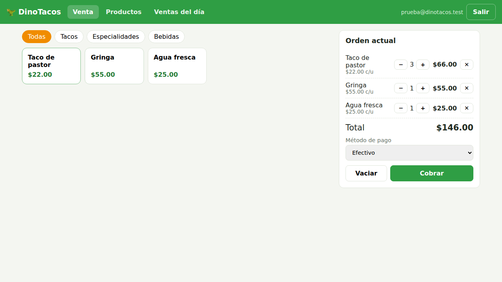
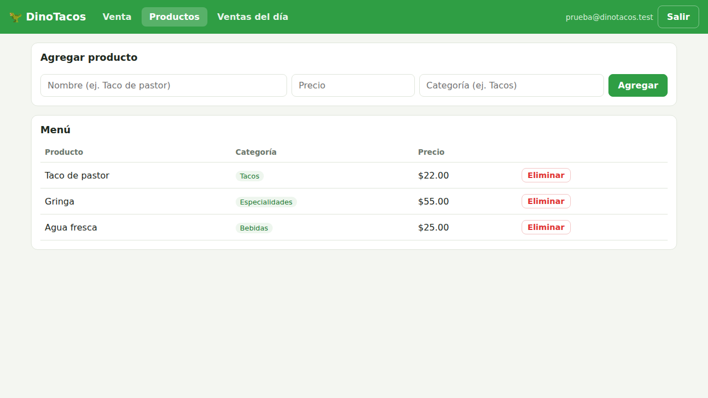
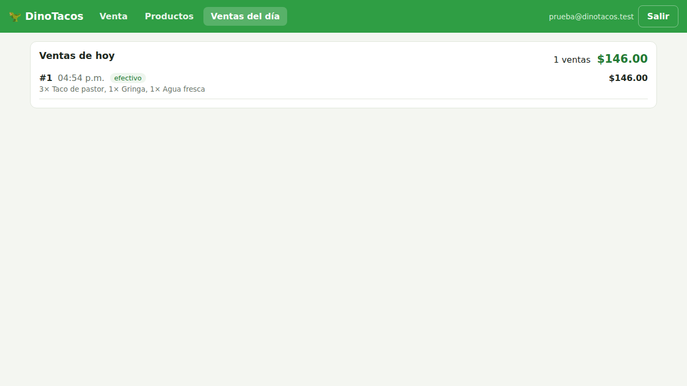

# 🦖 DinoTacos · Punto de venta

Punto de venta sencillo para el restaurante DinoTacos, conectado a su propio proyecto de Supabase (`dinotacos`, ref `vkiixgxhmqdzibylnxyy`).

## Qué hace

- **Venta**: tocas productos del menú para agregarlos a la orden, ajustas cantidades con − / +, quitas productos con ✕, y tocas **Cobrar**: se abre una ventana con el detalle y el total, eliges efectivo, tarjeta o transferencia y, en efectivo, escribes con cuánto paga el cliente (o tocas Exacto o un billete sugerido). El cambio se calcula mientras escribes, no deja cobrar si el pago no alcanza y al confirmar muestra en grande cuánto cambio entregar.
- **Productos**: agregas productos al menú (nombre, precio, categoría) y los eliminas.
- **Ventas**: el título es un selector entre **Ventas de hoy** (detalle de un día) y **Ventas del mes** (total del mes, desglose por método de pago, promedio por día y el total de cada día; toca un día para ver su detalle). Las flechas ◀ ▶ avanzan por día o por mes según la vista. Historial guardado en Supabase. Un administrador puede **cancelar** una venta escribiendo el motivo: no se borra, queda marcada y deja de contar en los totales. Muestra las ventas de hoy con su detalle, el total y el desglose por método de pago; con ◀ ▶ o el calendario consultas cualquier día anterior, y la lista "Últimos 30 días" muestra el total de cada día (tócalo para ver su detalle).
- **Corte de caja** (en la pestaña Ventas): al cerrar el día capturas el fondo inicial y el efectivo contado; la app calcula el efectivo esperado (fondo + ventas en efectivo no canceladas) y la diferencia (cuadra, faltan o sobran). Se guarda un corte por día; si hay cambios en las ventas después, avisa y se puede rehacer.

## Cómo correrlo

No necesita compilarse: son archivos estáticos (HTML, CSS y JS) que funcionan tal cual.

- **En línea**: https://danieldavb.github.io/dino_punto_de_venta/ (GitHub Pages con GitHub Actions: cada push que cambia la app se publica solo con `.github/workflows/pages.yml`, y también se puede lanzar a mano desde la pestaña Actions).
- **En tu computadora**: `npm install` y `npm run dev`, luego abre http://localhost:5173.

La URL y la clave publicable de Supabase están en `src/config.js`. La librería de Supabase va incluida en `vendor/supabase.js`; para actualizarla: `npm update @supabase/supabase-js && npm run vendor`.

## Cuentas del personal

Solo el personal **aprobado** puede ver o modificar datos (lo exige la base de datos con Row Level Security, no solo la app).

- **Crear cuenta**: cualquiera puede registrarse desde la pantalla de acceso (nombre, correo y contraseña). La cuenta queda **pendiente** y solo ve un aviso hasta que un administrador la apruebe.
- **Pestaña Personal** (solo administradores): lista las cuentas con las pendientes primero; permite **Aprobar**, **Hacer admin**, **Quitar admin** y **Quitar acceso**. Nadie puede cambiar su propio rol.
- **Invitar** desde [Supabase → Authentication → Users](https://supabase.com/dashboard/project/vkiixgxhmqdzibylnxyy/auth/users) (**Add user → Send invitation**): la cuenta entra ya aprobada como empleado y crea su contraseña al abrir el correo.

Si alguien olvida su contraseña, toca **¿Olvidaste tu contraseña?** en la pantalla de acceso. Se abre la sección **Recuperar contraseña**: escribe su correo y recibe un enlace que lo lleva a crear una contraseña nueva.

- Solo sirve el enlace del **correo más reciente**: cada correo nuevo invalida el anterior. Por eso el botón espera 60 segundos entre envíos.
- Si el enlace caducó o ya se usó, la app regresa a **Recuperar contraseña** para pedir otro.
- El servicio de correo incluido en Supabase manda muy pocos correos por hora y para todo el proyecto. Si el personal va a usarlo seguido, configura un SMTP propio en [Authentication → Emails → SMTP Settings](https://supabase.com/dashboard/project/vkiixgxhmqdzibylnxyy/auth/smtp).

Para que los enlaces de los correos abran la app, en [Authentication → URL Configuration](https://supabase.com/dashboard/project/vkiixgxhmqdzibylnxyy/auth/url-configuration) la **Site URL** debe ser `https://danieldavb.github.io/dino_punto_de_venta/` y esa misma dirección debe estar en **Redirect URLs**.

## Base de datos

El esquema está en `supabase/migrations/` (ya aplicado al proyecto):

| Tabla | Para qué |
| --- | --- |
| `productos` | El menú (nombre, precio, categoría) |
| `ventas` | Cada venta cobrada (total, método de pago, quién la hizo) |
| `cortes_caja` | Un corte por día: totales por método de pago, fondo inicial, efectivo esperado, contado y diferencia |
| `perfiles` | Una fila por cuenta: nombre, correo y rol (`pendiente`, `empleado` o `admin`) |
| `venta_items` | Productos de cada venta; guarda nombre y precio del momento, así borrar un producto no altera el historial |

Las ventas se registran con la función `registrar_venta` (guarda también `pago_con` y calcula `cambio`), se cancelan con `cancelar_venta` (solo administradores, con motivo) y el corte se guarda con `registrar_corte`, que calcula los totales en la base de datos. `registrar_venta` que toma los precios directamente de la tabla `productos` para que el total no se pueda alterar desde el navegador. Todas las tablas tienen Row Level Security activado.

## Capturas

| Venta | Productos | Ventas del día |
| --- | --- | --- |
|  |  |  |
